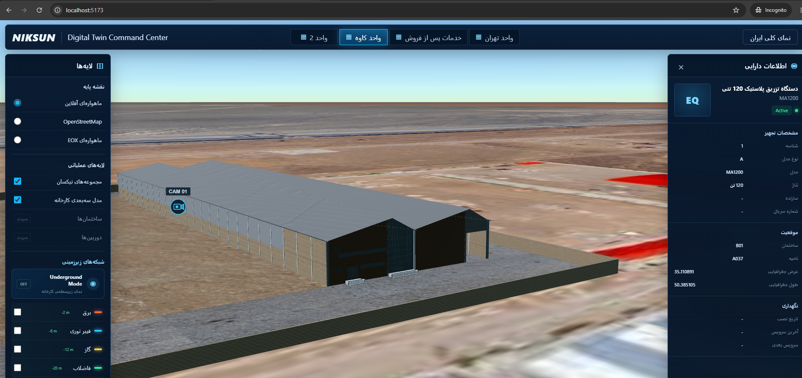
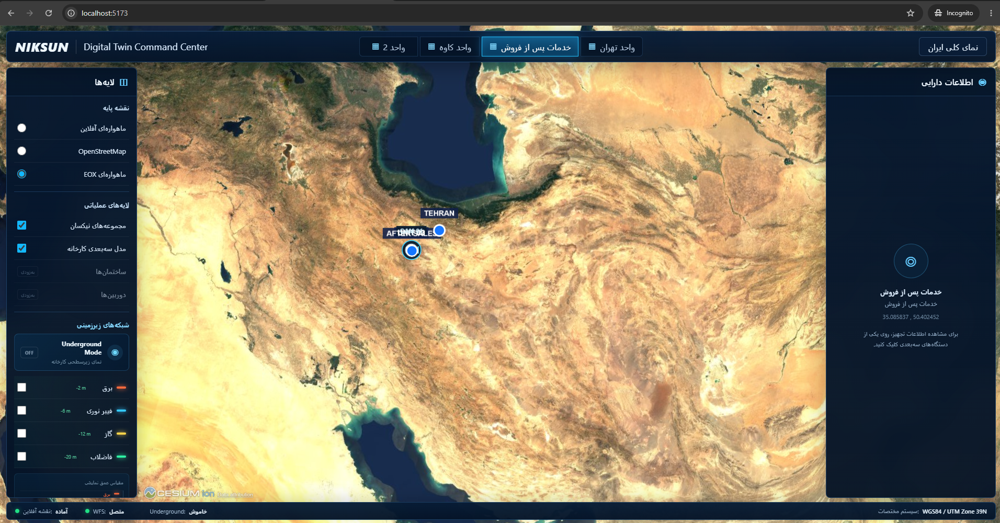
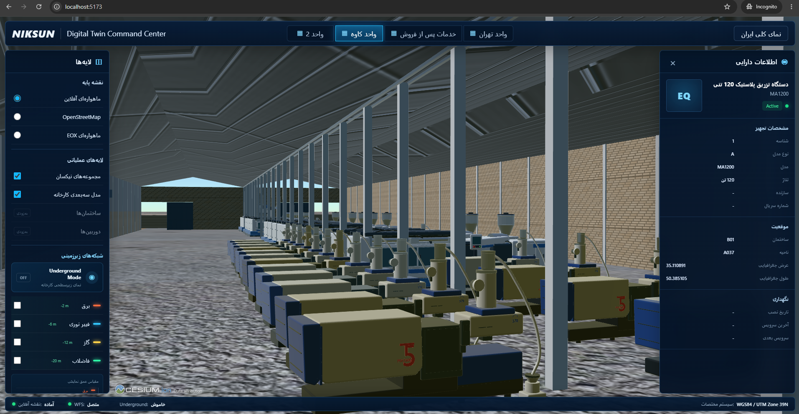

# Industrial Digital Twin & WebGIS

A web-based 3D Digital Twin and WebGIS project built with React, TypeScript, and CesiumJS.

The project started as an industrial GIS application for visualizing factory sites, infrastructure, equipment, and camera locations in an interactive 3D environment.


### 3D Factory Overview



### Multi-Site GIS Overview



### 3D Factory Interior & Equipment




## Current Features

- Interactive 3D map using CesiumJS
- Multiple industrial sites and locations
- GIS layer management
- Building and infrastructure visualization
- Interactive equipment information
- WFS / GeoJSON data integration
- Online and offline imagery layer support
- 3D model integration
- IP camera location visualization
- Live camera stream integration
- Custom dark UI for GIS controls and information panels

## Tech Stack

- React
- TypeScript
- CesiumJS
- Vite
- GIS / WebGIS
- WFS
- GeoJSON
- Mapbox
- QGIS Server
- RTSP / MediaMTX for camera streaming

## Portfolio Version

This repository is a public portfolio version of a larger industrial project.

Private network information and some large local datasets, including offline map tiles and production-specific assets, are not included in this repository.

The public version focuses on the application structure, GIS logic, 3D visualization, and user interface.

## Environment Variables

Create a `.env` file based on `.env.example`:

```env
VITE_MAPBOX_TOKEN=your_mapbox_token_here
```

## Installation

```bash
npm install
```

Run the development server:

```bash
npm run dev
```

Build the project:

```bash
npm run build
```

## Project Status

This project is still under development.

I'm currently working on improving the public demo version, adding reusable 3D GIS components, and preparing sample data that can be shared publicly.